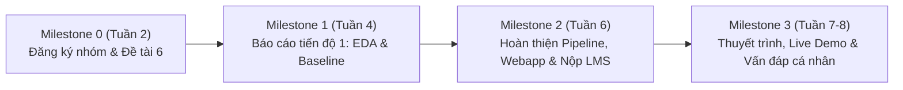

# KẾ HOẠCH PHÂN CÔNG CÔNG VIỆC & HƯỚNG DẪN VẤN ĐÁP BTL HỌC MÁY
## ĐỀ TÀI 6: PHÁT HIỆN GIAO DỊCH GIAN LẬN THẺ TÍN DỤNG (CREDIT CARD FRAUD DETECTION)
**Học phần:** Học máy (Machine Learning) - Mã HP: 608807  
**Khoa:** Công nghệ Thông tin - Trường Đại học Xây dựng Hà Nội (HUCE)  
**Nhóm thực hiện:** Nhóm 4 - Lớp: 68PM2  

---

## I. THÔNG TIN CHUNG & MỤC TIÊU ĐỀ TÀI

* **Tập dữ liệu:** Kaggle Credit Card Fraud Detection (284,807 giao dịch, 31 cột thuộc tính).
* **Đặc thù bài toán:** Cực kỳ mất cân bằng (chỉ có 492 giao dịch gian lận, chiếm tỷ lệ **~0.17%**).
* **Dạng bài toán:** Phân loại nhị phân trên dữ liệu mất cân bằng (Imbalanced Binary Classification).
* **Mục tiêu kỹ thuật & Tối ưu hóa:**
  * **Chỉ số đánh giá chính:** **PR-AUC (Precision-Recall Area Under Curve)** và **Recall** (kèm F2-Score, Precision, MCC).
  * **Tuyệt đối không dùng Accuracy** (vì mô hình ngây thơ luôn đoán giao dịch bình thường đã đạt Accuracy 99.83% nhưng bỏ sót 100% gian lận).
  * **Tối ưu hóa ngưỡng quyết định (Threshold Tuning):** Xác định ngưỡng tối ưu $p^*$ từ tập huấn luyện (Train set) thay vì dùng mặc định 0.5.
  * **Tuân thủ chống rò rỉ dữ liệu (Anti-Data Leakage):** Mọi phép chuẩn hóa, mã hóa, lấy mẫu (SMOTE/Undersampling) phải nằm trong Pipeline và chỉ fit trên tập Train.

---

## II. BẢNG PHÂN CÔNG NHIỆM VỤ CHI TIẾT (5 THÀNH VIÊN)

| STT | Thành viên | Vai trò & Mảng phụ trách | Nhiệm vụ kỹ thuật cụ thể | Sản phẩm / Deliverable bàn giao | Tỷ lệ đóng góp |
|:---:|:---|:---|:---|:---|:---:|
| **1** | **Bình** *(Nhóm trưởng)* | **Trưởng nhóm, Kiến trúc Pipeline, XGBoost & Triển khai Demo** | • Quản lý chung, lập kế hoạch, phân chia công việc và giám sát tiến độ. • Thiết kế cấu trúc tổng thể `imblearn.pipeline.Pipeline` kết hợp `ColumnTransformer`. • Huấn luyện, tinh chỉnh siêu tham số mô hình **XGBoost** (mô hình mạnh nhất). • Tối ưu ngưỡng quyết định (*Threshold Tuning* dựa trên F2-Score / chi phí rủi ro). • Đóng gói file mô hình `models/best_model.joblib`. • Phát triển Webapp Demo tương tác bằng **Streamlit** (`app.py`) phục vụ Live Demo. | • Module `fraud_pipeline.py` • File đóng gói `best_model.joblib` • Ứng dụng Streamlit `app.py` • Docker hóa dự án (`Dockerfile`, `docker-compose.yml`) | **20%** |
| **2** | **Đức Anh** | **Khám phá Dữ liệu (EDA), Tiền xử lý & Kỹ nghệ Đặc trưng (FE)** | • Tải, kiểm tra tính toàn vẹn dữ liệu gốc, phân tích tỷ lệ mất cân bằng (0.17%). • Loại bỏ dòng trùng lặp và phân chia tập dữ liệu **Stratified Train/Test (80/20)** chống rò rỉ dữ liệu. • Phân tích EDA chuyên sâu: phân phối `Amount`, biến thời gian `Time`, tương quan 28 biến PCA `V1..V28` với nhãn `Class`. • Xây dựng transformer `FraudFeatureEngineer`: tạo `Amount_log`, `Hour`, `Period`, `Hour_sin`, `Hour_cos`, `V_norm` và các biến tương tác PCA (`V14_x_V12`, `V14_x_V10`...). • Xây dựng bộ `ColumnTransformer` (StandardScaler cho V, RobustScaler cho Amount/Hour chống ngoại lai). | • Notebook `01_EDA_Preprocessing.ipynb` • Các biểu đồ EDA trong `reports/figures/` (01 đến 09) • Soạn nội dung **Chương 2** trong Báo cáo BTL | **20%** |
| **3** | **Hà Duy** | **Kỹ thuật Cân bằng Dữ liệu & Mô hình Cơ bản (Baseline, Logistic, k-NN)** | • Thử nghiệm & so sánh 3 chiến lược mất cân bằng: `class_weight`, `SMOTE` (Oversampling) và `RandomUnderSampler` (Undersampling). • Xây dựng mô hình cơ sở ngây thơ (**Baseline DummyClassifier**). • Triển khai thuật toán **Logistic Regression** (họ Tuyến tính) và **k-NN** (họ Lân cận). • Tối ưu hóa siêu tham số bằng `GridSearchCV` với metric `average_precision` (PR-AUC). • Lập bảng so sánh hiệu quả các chiến lược mất cân bằng trên từng mô hình. | • Code mô hình Logistic & k-NN trong `model_zoo.py` • Phần thực nghiệm tương ứng trong Notebook `02_Modeling_Evaluation.ipynb` • Bảng dữ liệu `imbalance_strategy_comparison.csv` | **20%** |
| **4** | **Hoàng** | **Mô hình Dựa trên Cây (Decision Tree, Random Forest) & Đánh giá chéo (CV)** | • Triển khai thuật toán **Decision Tree** và **Random Forest** (họ Cây & Mô hình tập hợp Bagging). • Thiết lập quy trình **5-Fold Stratified Cross-Validation** chuẩn mực. • Tối ưu hóa siêu tham số bằng `RandomizedSearchCV` (`n_estimators`, `max_depth`, `min_samples_leaf`, `max_samples`). • Thực hiện vẽ và phân tích biểu đồ **Learning Curve** (Đường cong học) và **Validation Curve** để đánh giá Overfitting/Underfitting. | • Code mô hình Tree/RF trong `model_zoo.py` • Biểu đồ `learning_curve.png`, `validation_curve.png` • Phần Cross-Validation trong Notebook `02_Modeling_Evaluation.ipynb` | **20%** |
| **5** | **Trần Duy** | **Đánh giá Chuyên sâu, Phân tích Lỗi (Error Analysis), XAI (SHAP) & Báo cáo** | • Tính toán bảng so sánh định lượng đa chỉ số: PR-AUC, ROC-AUC, Recall, Precision, F1, F2, MCC. • Vẽ Ma trận nhầm lẫn (**Confusion Matrix**) trên Test Set độc lập. • Mổ xẻ chi tiết các ca **False Negative** (bỏ lọt gian lận) và False Positive. • Phân tích tầm quan trọng của đặc trưng (**Permutation Importance** và **SHAP Summary Plot**). • Phụ trách tổng hợp, chuẩn hóa định dạng **Báo cáo kỹ thuật (15 - 25 trang A4)** và thiết kế **Slide thuyết trình (12 - 15 trang)** theo quy cách HUCE. | • Notebook mục Error Analysis & XAI • File báo cáo `Bao_cao_BTL_Nhom4.pdf` • File slide `Slide_Thuyet_trinh_Nhom4.pdf` • Bảng phân tích lỗi `false_negatives_test.csv` | **20%** |

---

## III. CÁC MỐC THỜI GIAN THEO DÕI TIẾN ĐỘ (MILESTONES)

* **Milestone 0 (Cuối buổi 2):** Đăng ký đề tài, danh sách thành viên nhóm 4. *(Đã hoàn thành)*
* **Milestone 1 (Cuối buổi 4):** Báo cáo tiến độ 1 trực tiếp trên lớp.
  * *Nội dung bàn giao:* Sơ đồ EDA, chiến lược tiền xử lý, Notebook chứa mô hình Baseline đầu tiên.
  * *Thành viên chủ lực:* **Đức Anh** (EDA) + **Hà Duy** (Baseline).
* **Milestone 2 (Trước Buổi 7 - 24h):** Đóng hệ thống nộp bài trên LMS.
  * *Nội dung bàn giao:* Toàn bộ gói sản phẩm hoàn chỉnh:
    1. `01_Report/Bao_cao_BTL_Nhom4.pdf` (15 - 25 trang).
    2. `02_Slide/Slide_Thuyet_trinh_Nhom4.pdf` (12 - 15 slide).
    3. `03_SourceCode/` (Code sạch, notebooks, `models/best_model.joblib`, `predict.py`, `app.py`, `README.md`, `Dockerfile`).
    4. `04_Video_Demo/` (Video demo dự phòng 3 phút).
  * *Thành viên chủ lực:* Cả nhóm cùng rà soát dưới sự điều phối của **Bình**.
* **Milestone 3 (Buổi 7 & Buổi 8):** Báo cáo thuyết trình trực tiếp tại giảng đường, Live Demo Webapp và trả lời vấn đáp cá nhân.

---

## IV. BỘ CÂU HỎI VẤN ĐÁP CÁ NHÂN & GỢI Ý TRẢ LỜI CHO TỪNG THÀNH VIÊN

> [!IMPORTANT]
> **Quy định Rubric của Khoa CNTT - HUCE:**
> * Điểm cá nhân = Điểm Nhóm $\times$ Hệ số Đóng góp cá nhân $\pm$ Điểm Vấn đáp cá nhân.
> * Sinh viên nào không nắm được mã nguồn do nhóm mình nộp sẽ bị hạ điểm độc lập.
> * Dưới đây là "phao kiến thức" trọng tâm để từng thành viên ôn luyện kỹ lưỡng trước khi gặp thầy cô.

---

### 1. DÀNH CHO BÌNH (Nhóm trưởng)

**Câu hỏi 1: Tại sao nhóm phải đóng gói toàn bộ luồng xử lý vào `Pipeline` của Scikit-learn / Imblearn mà không chạy từng bước rời rạc?**
* **Trả lời:** Đóng gói Pipeline mang lại 3 lợi ích cốt lõi:
  1. *Chống rò rỉ dữ liệu (Anti-Data Leakage):* Đảm bảo khi chạy K-Fold Cross Validation, các bước chuẩn hóa (scaler), điền giá trị thiếu (imputer) và lấy mẫu (SMOTE) chỉ được `fit` trên tập huấn luyện của fold đó, không bao giờ thấy dữ liệu validation.
  2. *Đồng nhất môi trường huấn luyện và suy luận:* Khi triển khai dự đoán cho dữ liệu mới trong thực tế (`predict.py` hoặc Streamlit), dữ liệu mới chỉ cần truyền qua Pipeline là tự động áp dụng đúng mọi biến đổi mà không cần viết lại mã tiền xử lý.
  3. *Tự động hóa hoàn toàn:* Dễ dàng tích hợp vào `GridSearchCV` hay `RandomizedSearchCV` để tinh chỉnh siêu tham số từ bước tiền xử lý đến mô hình cuối cùng.

**Câu hỏi 2: Tại sao phải dùng `imblearn.pipeline.Pipeline` thay vì `sklearn.pipeline.Pipeline` thông thường?**
* **Trả lời:** Vì trong Pipeline của nhóm có bước lấy mẫu lại (`SMOTE` hoặc `RandomUnderSampler`). Pipeline chuẩn của Scikit-learn chỉ hỗ trợ các bước có phương thức `transform()`, không hỗ trợ `sample()` của thư viện cân bằng dữ liệu. `imblearn.pipeline` cho phép áp dụng bộ lấy mẫu khi huấn luyện (`fit`), nhưng khi dự đoán (`predict` / `predict_proba`) nó sẽ tự động bỏ qua bộ lấy mẫu để dự đoán trực tiếp trên phân phối thực tế của dữ liệu.

**Câu hỏi 3: Thuật toán XGBoost hoạt động theo nguyên lý nào và vì sao nó lại đạt hiệu năng cao nhất trong đề tài này?**
* **Trả lời:** XGBoost (Extreme Gradient Boosting) là mô hình tập hợp học tăng cường (Boosting). Nó huấn luyện các cây quyết định tuần tự, trong đó mỗi cây sau sẽ học cách sửa sai phần dư (residuals / gradients) của các cây trước thông qua tối ưu hóa hàm mất mát bằng khai triển Taylor bậc hai. XGBoost vượt trội nhờ:
  - Có các thành phần điều chuẩn (Regularization $L_1, L_2$) giúp chống Overfitting.
  - Hỗ trợ tham số `scale_pos_weight` để phạt nặng việc phân loại sai lớp thiểu số (gian lận).
  - Thuật toán xấp xỉ biểu đồ tần suất (`tree_method='hist'`) giúp huấn luyện cực nhanh trên 284,807 dòng dữ liệu.

**Câu hỏi 4: Nhóm đã thực hiện Threshold Tuning (tối ưu ngưỡng quyết định) như thế nào? Tại sao không dùng ngưỡng mặc định 0.5?**
* **Trả lời:** Ngưỡng 0.5 chỉ tối ưu khi dữ liệu cân bằng 50:50 và chi phí sai lầm của 2 lớp bằng nhau. Với bài toán gian lận (tỷ lệ 0.17%), chi phí bỏ lọt gian lận (False Negative) đắt hơn rất nhiều so với báo động nhầm (False Positive). Nhóm đã dùng dự đoán Out-of-fold trên tập Train để quét các ngưỡng từ 0.01 đến 0.99 nhằm tối đa hóa chỉ số **F2-Score** (chỉ số ưu tiên Recall gấp đôi Precision). Kết quả chọn được ngưỡng tối ưu $p^* \approx 0.4671$, giúp tăng đáng kể tỷ lệ phát hiện gian lận.

---

### 2. DÀNH CHO ĐỨC ANH (EDA, Tiền xử lý & Kỹ nghệ Đặc trưng)

**Câu hỏi 1: Lỗi Rò rỉ Dữ liệu (Data Leakage) là gì? Nhóm đã ngăn chặn lỗi này như thế nào?**
* **Trả lời:** Data Leakage xảy ra khi thông tin từ tập kiểm thử (Test set) hoặc tập đánh giá (Validation fold) vô tình lọt vào quá trình huấn luyện mô hình, khiến kết quả đánh giá trên giấy tờ rất cao nhưng mô hình thất bại khi chạy dữ liệu thực tế. Nhóm đã ngăn chặn triệt để bằng cách:
  1. Loại bỏ dòng trùng lặp và chia ngay tập dữ liệu thành `Train` (80%) và `Test` (20%) phân tầng trước khi tiến hành EDA sâu.
  2. Tập Test được "đóng băng" hoàn toàn, chỉ dùng duy nhất một lần ở bước đánh giá cuối cùng.
  3. Lớp `FraudFeatureEngineer` được viết theo dạng *stateless* (hàm `fit` không học tham số gì từ dữ liệu mà chỉ tính toán dựa trên từng dòng độc lập).
  4. Mọi phép co giãn (Scaling) đều được đặt trong Pipeline, chỉ fit trên dữ liệu Train.

**Câu hỏi 2: Tại sao nhóm lại dùng `RobustScaler` cho cột `Amount` mà không dùng `StandardScaler` hay `MinMaxScaler`?**
* **Trả lời:** Cột số tiền `Amount` trong giao dịch có phân phối lệch phải cực kỳ nặng (Right-skewed) với nhiều giá trị ngoại lai cực lớn (giao dịch hàng chục nghìn USD so với trung bình vài chục USD). `StandardScaler` sử dụng giá trị trung bình (mean) và độ lệch chuẩn (std), `MinMaxScaler` dùng min và max, cả hai đều bị ảnh hưởng nghiêm trọng bởi các điểm ngoại lai. Trong khi đó, `RobustScaler` sử dụng Trung vị (Median) và Khoảng cách Tứ phân vị (IQR: $Q_3 - Q_1$), là các đại lượng kháng ngoại lai rất tốt, giúp dữ liệu không bị bóp méo.

**Câu hỏi 3: Nhóm đã sáng tạo những đặc trưng mới nào trong `FraudFeatureEngineer` và ý nghĩa nghiệp vụ của chúng là gì?**
* **Trả lời:** Nhóm tạo 6 nhóm đặc trưng nghiệp vụ:
  1. `Amount_log = log1p(Amount)`: Giảm độ lệch phải của phân phối số tiền.
  2. `Amount_small = (Amount < 1)`: Bắt các giao dịch "dò thẻ / quẹt thử" (Card Testing) thường thấy ở tội phạm mạng.
  3. `Hour = (Time % 86400) / 3600`: Chuyển đổi giây thành giờ trong ngày (0 - 24h).
  4. `Hour_sin`, `Hour_cos`: Mã hóa chu kỳ thời gian theo vòng tròn để máy hiểu 23h đêm sát với 0h sáng.
  5. `Period`: Phân loại khung giờ trong ngày (đêm, sáng, chiều, tối).
  6. `V_norm`: Chuẩn Euclidean $L_2$ của 28 biến PCA ($\sqrt{\sum V_i^2}$), đo mức độ bất thường tổng thể của giao dịch.
  7. Các biến tương tác PCA: `V14_x_V12`, `V14_x_V10`, `V14_x_V17`... vì đây là các biến có mối tương quan mạnh nhất với hành vi gian lận.

---

### 3. DÀNH CHO HÀ DUY (Chiến lược Cân bằng Dữ liệu & Mô hình Cơ bản)

**Câu hỏi 1: Bản chất toán học của kỹ thuật SMOTE là gì? Ưu và nhược điểm của nó trong đề tài này?**
* **Trả lời:** SMOTE (Synthetic Minority Over-sampling Technique) là kỹ thuật sinh mẫu tổng hợp cho lớp thiểu số:
  - *Nguyên lý:* Với mỗi mẫu gian lận $\mathbf{x}$, thuật toán tìm $k$ mẫu lân cận cùng lớp bằng khoảng cách Euclidean, chọn ngẫu nhiên một lân cận $\mathbf{x}_{nn}$, sau đó sinh mẫu mới theo công thức: $\mathbf{x}_{new} = \mathbf{x} + \lambda (\mathbf{x}_{nn} - \mathbf{x})$ với $\lambda \in [0, 1]$ (nội suy đoạn thẳng nối 2 điểm).
  - *Ưu điểm:* Tránh hiện tượng sao chép trùng lặp mẫu như Random Oversampling, giúp mở rộng biên quyết định.
  - *Nhược điểm:* Khi các mẫu gian lận nằm lẫn vào vùng giao dịch bình thường, SMOTE có thể sinh ra các mẫu nội suy nằm sâu trong vùng an toàn, tạo ra nhiễu và làm tăng tỷ lệ báo động nhầm (False Positive).

**Câu hỏi 2: Phân tích ưu nhược điểm của 3 chiến lược: `class_weight`, `SMOTE` và `Undersampling`?**
* **Trả lời:**
  - `class_weight`: Tăng hình phạt của hàm mất mát đối với lớp thiểu số mà không thay đổi phân phối mẫu. Không tăng kích thước dữ liệu, chạy nhanh và giữ toàn vẹn thông tin.
  - `SMOTE`: Tăng cường lớp thiểu số bằng mẫu tổng hợp. Hiệu quả tốt với Logistic Regression nhưng sinh thêm dữ liệu làm tăng thời gian huấn luyện.
  - `Undersampling`: Bỏ bớt mẫu lớp đa số (giao dịch bình thường). Huấn luyện cực kỳ nhanh nhưng nhược điểm lớn là vứt bỏ phần lớn thông tin hữu ích của tập dữ liệu.

**Câu hỏi 3: Tại sao k-NN lại chạy rất chậm và không thể kết hợp với SMOTE trên tập dữ liệu này?**
* **Trả lời:** k-NN là thuật toán Lazy Learning, không có pha huấn luyện tham số mà phải tính toán khoảng cách từ điểm cần dự đoán tới toàn bộ các điểm trong tập huấn luyện (hơn 227,000 mẫu ở 43 chiều đặc trưng). Độ phức tạp tính toán là $\mathcal{O}(N \times d)$. Nếu áp dụng thêm SMOTE, số lượng mẫu $N$ tăng lên gấp nhiều lần, khiến thời gian tính toán tăng đột biến, gây nghẽn bộ nhớ. Vì vậy, nhóm chỉ áp dụng Undersampling khi thử nghiệm với k-NN.

---

### 4. DÀNH CHO HOÀNG (Tree-based Models & Cross-Validation)

**Câu hỏi 1: Hiện tượng Quá khớp (Overfitting) xảy ra ở Decision Tree như thế nào và nhóm đã kiểm soát ra sao?**
* **Trả lời:** Decision Tree không bị giới hạn sẽ tiếp tục phân nhánh cho đến khi mọi nút lá đều thuần nhất ($Gini = 0$). Lúc này cây sẽ "học vẹt" từng nhiễu nhỏ của tập train, dẫn đến Overfitting trầm trọng (Train PR-AUC = 1.0 nhưng Test PR-AUC rất thấp). Nhóm đã kiểm soát bằng các kỹ thuật cắt tỉa cây (*Pruning*) thông qua `RandomizedSearchCV`:
  - Giới hạn độ sâu tối đa (`max_depth = 4, 6, 8`).
  - Đặt số lượng mẫu tối thiểu ở nút lá (`min_samples_leaf = 5, 20, 50`).

**Câu hỏi 2: Random Forest giải quyết nhược điểm của Decision Tree bằng cơ chế nào?**
* **Trả lời:** Random Forest sử dụng kỹ thuật tập hợp **Bagging (Bootstrap Aggregating)** kết hợp **Random Subspace**:
  1. *Bootstrap:* Tạo nhiều cây quyết định độc lập, mỗi cây được huấn luyện trên một tập con lấy mẫu có hoàn lại từ tập dữ liệu gốc.
  2. *Feature Subsampling:* Tại mỗi nút phân nhánh, chỉ lấy ngẫu nhiên một tập con đặc trưng (thường là $\sqrt{d}$) để tìm đặc trưng phân chia tốt nhất, giúp các cây không bị tương quan với nhau.
  3. Kết quả cuối cùng là bầu chọn số đông hoặc trung bình xác suất của tất cả các cây, giúp giảm phương sai (Variance) mà không làm tăng độ chệch (Bias).

**Câu hỏi 3: Tại sao nhóm phải dùng Stratified K-Fold thay vì K-Fold thông thường? Làm sao để đọc biểu đồ Learning Curve?**
* **Trả lời:**
  - *Stratified K-Fold:* Vì tỷ lệ gian lận chỉ có 0.17%, nếu chia ngẫu nhiên K-Fold thông thường, có thể có những fold không chứa hoặc chứa quá ít mẫu gian lận, làm kết quả đánh giá bị sai lệch nghiêm trọng. Stratified K-Fold đảm bảo mọi fold đều duy trì chính xác tỷ lệ 0.17% gian lận.
  - *Biểu đồ Learning Curve:* Thể hiện hiệu năng mô hình (PR-AUC) trên tập Train và tập Validation khi kích thước mẫu tăng dần. Nếu đường Train score và Validation score đều cao và hội tụ sát nhau $\rightarrow$ mô hình đạt độ cân bằng tốt giữa Bias và Variance.

---

### 5. DÀNH CHO TRẦN DUY (Đánh giá Chuyên sâu, Phân tích Lỗi & XAI)

**Câu hỏi 1: Tại sao trong bài toán này PR-AUC lại vượt trội và phản ánh đúng bản chất hơn ROC-AUC?**
* **Trả lời:**
  - ROC-AUC vẽ mối quan hệ giữa **True Positive Rate (Recall)** và **False Positive Rate (FPR)**: $FPR = \frac{FP}{FP + TN}$. Do số lượng giao dịch bình thường ($TN$) quá lớn (~284,000), mẫu số rất lớn khiến FPR luôn rất nhỏ, làm đường cong ROC bị đẩy vồng lên góc trên bên trái tạo cảm giác mô hình hoàn hảo (ROC-AUC thường $\ge 0.98$ dù mô hình dự đoán nhầm hàng trăm ca).
  - PR-AUC vẽ mối quan hệ giữa **Precision** ($\frac{TP}{TP + FP}$) và **Recall** ($\frac{TP}{TP + FN}$). Cả hai trục đều chỉ tập trung vào lớp thiểu số (gian lận), không hề phụ thuộc vào $TN$. Do đó, PR-AUC phản ánh chân thực và khắt khe năng lực bắt gian lận của mô hình.

**Câu hỏi 2: Ý nghĩa của F2-Score so với F1-Score trong bài toán gian lận tài chính là gì?**
* **Trả lời:** Công thức tổng quát của $F_\beta$:
  $$F_\beta = (1 + \beta^2) \frac{\text{Precision} \times \text{Recall}}{\beta^2 \text{Precision} + \text{Recall}}$$
  - Khi $\beta = 1$ (F1-Score): Precision và Recall có trọng số ngang nhau.
  - Khi $\beta = 2$ (F2-Score): Recall được nhân trọng số gấp đôi Precision ($\beta^2 = 4$). Trong nghiệp vụ ngân hàng, việc bỏ sót 1 vụ gian lận (tổn thất hàng chục nghìn USD) nguy hiểm hơn nhiều so với việc cảnh báo nhầm 1 giao dịch an toàn (chỉ tốn tin nhắn SMS/OTP). Do đó, F2-Score là thước đo hoàn hảo để phản ánh mục tiêu kinh doanh.

**Câu hỏi 3: Biểu đồ SHAP (Shapley Additive Explanations) cho biết điều gì về mô hình của nhóm?**
* **Trả lời:** SHAP dựa trên lý thuyết trò chơi hợp tác (Game Theory) để tính toán mức độ đóng góp công bằng của từng đặc trưng vào việc tăng hay giảm xác suất gian lận của một giao dịch cụ thể:
  - Biểu đồ **SHAP Summary Plot** xếp hạng theo Mean |SHAP|: $V_4$ (1,042), $V_{14}$ (0,868), $V_{12}$ (0,480),
    $V_{14}\times V_{10}$ (0,431), $V_{11}$ (0,294), $V_8$ (0,285). Lưu ý $V_{10}$ và $V_{17}$ đứng riêng lẻ chỉ ở hạng
    8 và 15 — chúng đóng góp chủ yếu *gián tiếp* qua các biến tương tác $V_{14}\times V_{10}$ (hạng 4) và
    $V_{14}\times V_{17}$ (hạng 9).
  - Cụ thể: khi giá trị của $V_{14}$ hoặc $V_{12}$ càng âm sâu, giá trị SHAP càng dương mạnh (tới +3,0 với $V_{14}$)
    $\rightarrow$ đẩy xác suất dự đoán giao dịch đó thành gian lận lên rất cao. Với $V_4$ thì ngược lại: giá trị càng
    **cao** thì càng đẩy về phía gian lận. Lưu ý: $V_1..V_{28}$ là thành phần PCA đã ẩn danh nên chỉ giải thích được
    *hướng* ảnh hưởng, không quy được về nghiệp vụ cụ thể. Điều này vẫn giúp ngân hàng giải thích lý do chặn cho khách
    hàng và cơ quan thanh tra.

---

## V. NỘI DUNG CAM KẾT & CHỮ KÝ XÁC NHẬN

* Cả 5 thành viên cam kết tự làm chủ phần mã nguồn và nội dung báo cáo do mình phụ trách.
* Tuân thủ quy định học thuật: Tuyệt đối không sao chép nguyên văn đồ án từ nguồn khác; hiểu sâu từng dòng lệnh để trả lời xuất sắc vấn đáp cá nhân.

| Thành viên | Chữ ký xác nhận |
|:---|:---:|
| **Bình (Nhóm trưởng)** | *Đã xác nhận* |
| **Đức Anh** | *Đã xác nhận* |
| **Hà Duy** | *Đã xác nhận* |
| **Hoàng** | *Đã xác nhận* |
| **Trần Duy** | *Đã xác nhận* |

